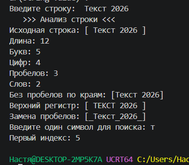

# Практическая работа №19
Автор: Пономарева Анастасия 
Группа: ИСП-252

## Тема
Строки в C#.

## Что реализовано
- определение длины строки;
- подсчёт букв, цифр, пробелов и слов;
- поиск первого индекса символа;
- удаление пробелов по краям;
- перевод в верхний регистр;
- замена пробелов на подчёркивания.

## Короткие ответы

1. Чем отличаются `string` и `char`?
Ответ: `string` - это последовательность символов, строка записывается
в двойных кавычках и имеет длину и методы. `char` - один отдельный символ,
записывается в одинарных кавычках. `'7'` - это символ, а `7` -
число; `"П"` - строка, а `'П'` - символ

2. Почему вызов `text.Trim()` без сохранения результата не меняет `text`?
Ответ: строки в C# неизменяемы - их содержимое нельзя переписать на месте.
`Trim()` не изменяет исходную строку, а возвращает новую строку без пробелов
по краям. Если результат не сохранить в переменную, он потеряется.
Поэтому нужно писать `text = text.Trim();`

3. Зачем при разделении строки используется `RemoveEmptyEntries`?
Ответ: без него `Split()` создаёт пустые элементы там, где стоят пробелы
по краям строки или несколько пробелов подряд. Из-за этого слова считаются
неправильно: например, `" кот  дом "` дал бы четыре элемента вместо двух.
С `RemoveEmptyEntries` пустые части отбрасываются и остаются только
слова

## Результат


```